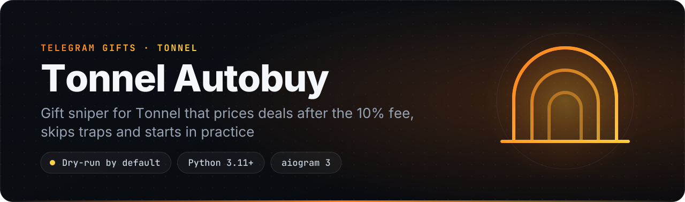
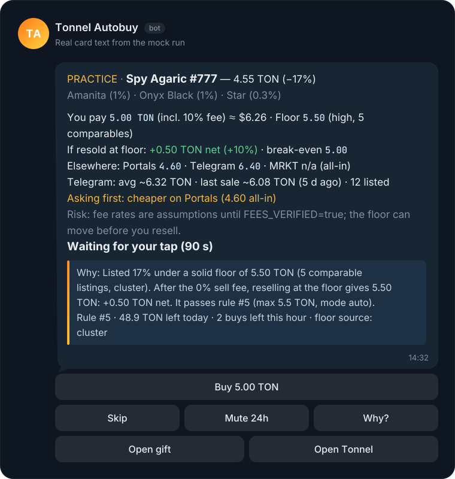
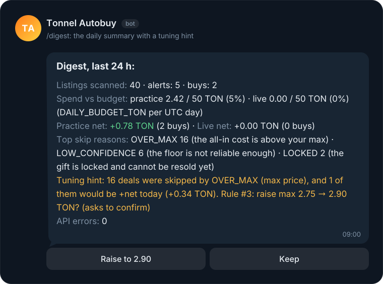
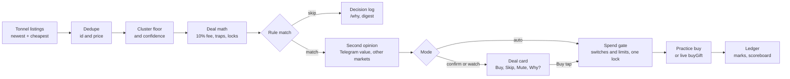

<p align="center">
  
</p>

<p align="center">
  
  
  
  
  
  
  
  
</p>

<p align="center">
  <b>A self-hosted Telegram gift sniper for Tonnel that counts the 10% fee, filters out traps and only buys when the net numbers hold up.</b><br>
  <a href="#features">Features</a> · <a href="#quick-start">Quick start</a> · <a href="#commands">Commands</a> · <a href="#how-it-works">How it works</a> · <a href="#safety">Safety</a> · <a href="#roadmap">Roadmap</a>
</p>

Tonnel Autobuy watches the [Tonnel](https://t.me/Tonnel_Network_bot) marketplace for Telegram gifts that match your rules. It sends you a deal card for each match and, if you allow it, buys.

A discount to the floor is not a profit. Tonnel adds a 10% buy fee on top of the listed price, cheap listings can be traps, and a "floor" can be one seller's two asks. A public paper-trading test of 639 gift resales ([ufosog/gift-sniper](https://github.com/ufosog/gift-sniper)) found a median result of −2.0%, and only 10% of trades made money. This bot works out what you actually pay, what a resale at a well-backed floor leaves you, and whether other markets or Telegram itself price the gift lower.

It starts in practice mode and stays there until you switch live mode on. Live mode lasts 24 hours at a time, within hard limits, and `/panic` stops it at once. Everything runs on your own server, Telegram account and Tonnel balance: no deposits, no shared sessions, no closed binaries.

> **Status: alpha.** The full pipeline runs offline in `mock` mode and in 259 tests. The Tonnel endpoints come from the community library `tonnelmp` 1.2 and the Tonnel web app. The listing search and the single-listing re-check were checked live, but no real purchase has been made through this bot yet. Read [Before going live](#before-going-live) first.

## Why it's different

- **Profit after Tonnel's 10% fee, not discount to floor.** Tonnel lists prices without its buy fee. This bot adds the fee to every cost, every rule max and every spending limit. The rate is a setting, marked unverified until you check it. Each card shows what you pay, the net result of a resale at the floor and the break-even price. A deal that loses money after fees is skipped, however big the discount looks.
- **A floor you can trust, with a confidence level.** Snipers that compare against the second-cheapest ask can be fooled by one seller with two cheap listings. This bot uses a cluster floor: the lowest ask with at least two other asks within 10% above it. Each floor is labeled `high`, `med` or `low` by how many comparable listings back it: a floor without a cluster of at least 3 listings is always `low`, so two decoy asks can never pass the default `min_confidence=med`. A floor also drops a level when it moves more than 25% within an hour.
- **Traps are filtered before any math.** Listings priced in another asset (such as USDT), bundles, auctions and listings without a price unit are blocked. A gift with a future `export_at` date counts as locked. A price under 25% of the floor is never bought automatically; you get a card instead.
- **A second opinion before it spends.** The bot checks Telegram's own valuation of the exact gift (`payments.getUniqueStarGiftValueInfo`, which none of the snipers we reviewed use). It also compares the same gift on Portals and MRKT, and optionally on Telegram's own resale market. If the gift is cheaper elsewhere, or priced above Telegram's value (its average or last sale) on a thin floor, the bot asks you instead of buying.
- **It proves itself before it touches your money.** Alert feeds stop at a notification, and custodial sniper bots ask for a deposit and keep their logic closed. This bot runs on your account, logs every decision including each skip, and explains it with `/why`. Practice buys are marked against the floor and reported net of fees in `/scoreboard`, which also counts races you probably lost. Live mode turns itself off after 24 hours.

## Features

| | Feature | What you get |
|---|---|---|
| 🎯 | **Rule-based sniping** | Rules by collection, model, backdrop and symbol, with a max price (fee included), min discount, min net profit in TON or %, min floor confidence and lock tolerance. Polls Tonnel every 2 s for the newest and the cheapest listings. |
| 🧮 | **Net-of-fees math** | All-in cost, net exit at the floor, profit in TON and %, and the break-even price on every card, plus an optional USD amount. |
| 📉 | **Honest floor** | A cluster floor with `high`/`med`/`low` confidence, floor snapshots over time, and a fallback to Tonnel's own floors. |
| 🪤 | **Trap and lock filter** | Other-asset listings, bundles, auctions and unknown price units are blocked. `export_at` locks are skipped unless a rule allows them. Too-good-to-be-true prices always ask first. |
| 🃏 | **Deal cards** | Per-rule mode: `auto`, `confirm` or `watch`. Buttons for Buy, Skip, Mute 24h and Why?. The listing is re-checked before a tap buys, cards expire after 90 s, and a double tap is safe. |
| 🤏 | **Near-miss nudges** | A silent card when one check misses by 5% or less, with a one-tap "Raise max" (at most 3 an hour). |
| 🔍 | **Second opinion** | Telegram's valuation (average, last sale, listed count), Portals and MRKT floors, optional Telegram resale quotes, and `/compare` across markets, all-in and net. |
| 🧪 | **Practice first** | A practice ledger with marks, `/pnl`, `/scoreboard`, per-rule verdicts, CSV export, and a live gate that expires after 24 h. |
| 🛡️ | **Safety envelope** | `/safety`, `/panic`, limit presets that can only tighten, and breakers for a floor crash, a losing streak, a balance mismatch and repeated failed buys. |
| 🪄 | **`/hunt` wizard** | Set up a rule in at most 6 taps, using Tonnel's per-model floors, or paste a `t.me/nft/...` link. It shows what the rule would have caught in the last 24 h before you save. |
| 🌓 | **Shadow rules** | New rules start in shadow (practice only, even in live mode). Each would-be buy is recorded and revalued net of fees, and a hindsight card offers to promote the rule once it has enough data. |
| 🧾 | **Explained decisions** | Every evaluation goes to a `decisions` table and `data/events.jsonl`. You also get `/why`, an optional daily digest with tuning hints, and an optional "Explain more" button that uses Claude. |
| 🩺 | **`/doctor`** | Checks config, Telegram session, 2FA, session file permissions, Tonnel auth, reachability, clock, database, fees and limits, with a fix for each failing item. |

## See it in action

<p align="center">
  
</p>

The rule is in `auto` mode and the deal is +0.50 TON net after the 10% fee, but the same gift costs 4.60 TON all-in on Portals, so the bot asks first instead of buying.

An excerpt of `python -m tonnel_autobuy mock --cycles 2`, which runs offline with fixture data and no keys:

```text
MOCK mode: fake Tonnel client, 6 demo rules, 2 cycles, PRACTICE forced (DRY_RUN lock), tap=none
  ...
  Fees: buy 10% · sell 0% · withdraw 0 TON (unverified)

--- cycle 1 ---
[notify] NEAR MISS PRACTICE · Desk Calendar #3001 — 2.60 TON (−19%)
  Missed by a hair: 2.86 TON, your max is 2.75
  ...
  [buttons: Raise max to 2.90 | Ignore today | Why? | Mute 24h]
[notify] DEAL Lunar Snake #4410 1.00 TON · floor 1.60 (cluster, 4 comparables, high) · you pay 1.10 incl. 10% fee · resold at floor: +0.50 TON net (+45%) · break-even 1.45
  PRACTICE · Lunar Snake #4410 — 1.00 TON (−38%)
  Albino (1.2%) · Onyx Black (1%) · Star (0.3%)
  You pay 1.10 TON (incl. 10% fee) ≈ $1.38 · Floor 1.60 (high, 4 comparables)
  If resold at floor: +0.50 TON net (+45%) · break-even 1.45
  Elsewhere: Portals 1.75 · Telegram 1.95 · MRKT n/a (all-in)
  Telegram: avg ~2.00 TON · last sale ~1.92 TON (3 d ago) · 41 listed
  Risk: fee rates are assumptions until FEES_VERIFIED=true; the floor can move before you resell.
  PRACTICE: would buy
  ...
cycle 1: rules=6 fetched=30 new=30 matched=5 rejected=25 dry_buys=1 buys=0 cards=4 skipped=0 failed=0 · requests=13
  skip #4412 0.97 TON: loses 0.07 TON after fees (rule #2)
  skip #4420 1.00 TON: cost 1.10 incl. fees > max 1.08 (rule #2)
  ...
  skip #54 1.10 TON: priced in USDT, not TON (rule #4)
  skip #53 1.20 TON: locked: export_at: unlocks in 6 d (rule #4)
  ...

--- /scoreboard ---
Practice scoreboard, last 7 days (net of fees):
Would have bought: 10 gifts for 12.04 TON all-in
Worth now if resold at floor: 14.11 TON net
Would-be P&L: +2.1 TON (unrealized +2.1 TON, realized +0.0 TON)
Races probably lost: 0 of 2 practice buys (listing gone within 2 min)
Rule #1: ready · Rule #2: losing · Rule #3: not enough data · Rule #4: not enough data · Rule #5: not enough data · Rule #6: not enough data → go-live needs /dry off confirm
Practice assumes you won every race for the listing; real results are worse.

--- summary ---
...
client.buy() calls: 0 (practice never buys)
skip reasons: OVER_MAX 16 · LOW_CONFIDENCE 6 · LOSES_AFTER_FEES 1 · TRAP_ASSET 1 · LOCKED 1 · ABOVE_TG_VALUE 1 · CHEAPER_ELSEWHERE 1 · TOO_GOOD 1
```

The mock run also prints `/pnl`, `/score`, shadow fills, the `/dry off` gate, `/why`, the digest, `/safety`, `/peers` and `/compare`. Extra flags show the other paths:

- `--tap buy` re-checks before a tapped buy (`[tap buy] price changed 2.20 → 2.40, not bought`), handles double taps and hits the hourly cap.
- `--crash` fires the floor-crash breaker (`[notify] Rule #2 paused for 60 min: floor −30% in 1 h`).
- `--panic` presses `/panic` after cycle 1, then shows `/resume` with its `[Confirm resume]` step and an older resume button that no longer works.
- `--preview "<rule>"`, `--doctor` and `--shadow-hours 0` show the `/hunt` preview, `/doctor` and the shadow hindsight card.

<p align="center">
  
</p>

The digest counts what was scanned, spent and skipped. When a rule's own max hid a deal that would be profitable today, it offers to raise it. "Raise" only asks for confirmation, and `MAX_PRICE_TON` still caps every buy.

## Quick start

1. **Try it with zero keys.** Clone, install, and run the offline mock. You need Windows 10/11 (x64) with Python 3.11 or newer. In the clone URL, replace `watchflowguide` with the GitHub account this repository lives under (the name at the top of its GitHub page), or copy the URL from the green **Code** button.

   ```powershell
   git clone https://github.com/watchflowguide/tonnel-telegram-gifts-sniper.git
   ```
   ```powershell
   cd tonnel-autobuy
   ```
   ```powershell
   py -3 -m venv .venv
   ```
   ```powershell
   .venv\Scripts\pip install -r requirements.txt
   ```
   ```powershell
   .venv\Scripts\python -m tonnel_autobuy mock --cycles 2
   ```

2. **Create your bot.** In Telegram, open [@BotFather](https://t.me/BotFather), send `/newbot`, choose a name and a username, and copy the token it gives you. That token is `BOT_TOKEN`.

3. **Find your numeric Telegram ID.** Send any message to [@userinfobot](https://t.me/userinfobot). It replies with your `Id`, which goes in `ADMIN_IDS`. Only these IDs can use the bot and its buttons; separate several with commas.

4. **Get Telegram API credentials.** Sign in at [my.telegram.org](https://my.telegram.org), open *API development tools* and create an app. Copy `api_id` and `api_hash` into `TG_API_ID` and `TG_API_HASH`. The bot uses them to open the Tonnel Mini App as you, which is how Tonnel authenticates. They also enable Telegram's valuation and the `/hunt` wizard. Practice scanning works without them, because Tonnel's listing search is public.

5. **Configure `.env`.** Copy the example, then fill in the four keys from steps 2-4. Leave `DRY_RUN=true` for now.

   ```powershell
   copy .env.example .env
   ```

6. **Log in once.** This asks for your phone number, the login code and your 2FA password if you have one. It saves the session to `data/tonnel.session` (mode 600), then opens the Tonnel Mini App once to fetch `initData` as a check.

   ```powershell
   .venv\Scripts\python -m tonnel_autobuy login
   ```

7. **Check the setup.** Each failing item comes with a fix. The exit code is 1 if anything fails.

   ```powershell
   .venv\Scripts\python -m tonnel_autobuy doctor
   ```

8. **Run it.**

   ```powershell
   .venv\Scripts\python -m tonnel_autobuy run
   ```

9. **Add your first rule.** In your bot, send `/start`. With no rules yet, it opens the `/hunt` wizard. Without Tonnel auth, use `/addrule` instead, for example `/addrule Toy Bear max=12 discount=25 mode=confirm`. Watch `/scoreboard` for a few days before you consider `/dry off`.

## Self-hosting

The bot is a single Python process with a SQLite database in `data/`. It needs no inbound ports, because it polls Telegram and Tonnel.

### Windows

This is a Windows build: install it on Windows 10/11 (x64) with Python 3.11 or newer from [python.org](https://www.python.org/downloads/windows/) (tick *Add python.exe to PATH*). The CLI refuses to start anywhere else (`This build is Windows-only.`), because the packaged companion runtime is a Windows program.

1. Get the code and set up a virtual environment:

   ```powershell
   git clone https://github.com/watchflowguide/tonnel-telegram-gifts-sniper.git
   cd tonnel-autobuy
   py -3 -m venv .venv
   ```

2. Install, configure, log in and check, as in Quick start steps 4-7:

   ```powershell
   .venv\Scripts\pip install -r requirements.txt
   ```
   ```powershell
   copy .env.example .env
   ```
   ```powershell
   .venv\Scripts\python -m tonnel_autobuy login
   ```
   ```powershell
   .venv\Scripts\python -m tonnel_autobuy doctor
   ```

3. Start it, and keep it running. The bot runs in the window you start it from; close the window and it stops. To start it with the machine, register it with Task Scheduler:

   ```powershell
   .venv\Scripts\python -m tonnel_autobuy run
   ```
   ```powershell
   schtasks /Create /TN "tonnel_autobuy" /TR "cmd /c cd /d %USERPROFILE%\tonnel-autobuy && .venv\Scripts\python -m tonnel_autobuy run" /SC ONLOGON
   ```
Install on Windows only: there is no Docker image and no Linux service file in this release.

### Free by default

Everything in this repo works without paid API keys.

| Key | Required? | Where to get it | Cost |
|---|---|---|---|
| `BOT_TOKEN` | Yes, for the admin bot. Without it, `run` prints alerts to stdout | [@BotFather](https://t.me/BotFather) → `/newbot` | Free |
| `ADMIN_IDS` | Yes, when `BOT_TOKEN` is set | [@userinfobot](https://t.me/userinfobot) shows your numeric ID | Free |
| `TG_API_ID`, `TG_API_HASH` | Yes, for Telegram's valuation and `TG_MARKET`, and for Tonnel auth (live buys, `/balance`, Tonnel's own floors, `/hunt`) unless you use `TONNEL_INIT_DATA`. Not needed for practice scanning | [my.telegram.org](https://my.telegram.org) → API development tools | Free |
| `TONNEL_INIT_DATA` | No. A manual alternative to the Telethon login; it cannot refresh itself | market.tonnel.network → DevTools → Local Storage → `web-initData` | Free |
| `PROXY` | No | Any HTTP or SOCKS5 proxy, if Tonnel or Cloudflare rate-limits your IP | Your proxy provider's price |
| `TON_RATE_URL` | No (preset) | tonapi.io public rates endpoint, no key | Free |
| `PEER_PORTALS_PUBLIC` | No (off) | Portals' public collections endpoint, no key | Free |
| `PEER_FLOOR_FILES` | No | Floor snapshot files written by other bots you run (schema below) | Free |
| `TG_MARKET` | No (off). Needs the Telegram login | Telegram's own resale market through your session | Free |
| `ANTHROPIC_API_KEY` | No (also needs `pip install anthropic`) | [console.anthropic.com](https://console.anthropic.com) | Paid per use. Without it the "Explain more" button is hidden and no call is made; `/why` works without it |

Live buying needs TON on your Tonnel balance. Practice mode needs none.

## Configuration

All settings live in `.env`. If a required key is missing, the command stops with one line such as `Config error: ADMIN_IDS is empty in .env: set your Telegram user id(s)`.

| Key | Default | Meaning |
|---|---|---|
| `DRY_RUN` | `true` | Hard practice lock. While it is `true`, no bot command or stored setting can turn on live mode, and an armed live window is cancelled for good. |
| `MAX_PRICE_TON` | `20` | Max all-in cost of one gift, the 10% fee included. Caps every rule. |
| `DAILY_BUDGET_TON` | `50` | Spend limit per UTC day, all-in. |
| `MAX_BUYS_PER_HOUR` | `3` | Max buys in the last hour. |
| `LIVE_ARM_HOURS` | `24` | How long live mode lasts, once `/dry off` is confirmed, before it reverts to practice. |
| `CONFIRM_ABOVE_TON` | `0` | Buys above this always ask first, even in `auto`. `0` means half of `MAX_PRICE_TON`. |
| `BUY_FEE_PCT` | `10` | Tonnel's buy fee on top of the listed price. `FEE_PCT` is a deprecated alias. |
| `FEES_VERIFIED` | `false` | Set to `true` once you have checked Tonnel's fees. Until then, cards and `/status` say the fees are assumptions. |
| `EXPORT_AT_LOCKS` | `true` | Treat a future `export_at` as a lock. See [Before going live](#before-going-live): with `true`, a large share of the live market can be skipped. |
| `SHADOW_NEW_RULES` | `true` | New rules start in shadow (practice only) until promoted. |
| `POLL_INTERVAL` | `2` | Seconds between cycles. On 429s, Cloudflare 403s and errors it backs off exponentially, up to `MAX_BACKOFF`. |
| `RULES_FILE` | `rules.json` | Optional rules file, loaded at every start. |
| `TZ_OFFSET_HOURS` | `0` | Your offset from UTC in hours (`3` for UTC+3). It sets the times `/why` shows, the digest hour and when "Ignore today" ends. Budgets always use the UTC day. |

<details>
<summary>All settings</summary>

Every key is documented in [`.env.example`](.env.example), in these groups:

- **Admin bot:** `BOT_TOKEN`, `ADMIN_IDS`
- **Telegram account (Telethon):** `TG_API_ID`, `TG_API_HASH`, `TG_SESSION`, `TONNEL_BOT_USERNAME`, `TONNEL_APP_SHORT_NAME`, `TONNEL_WEBAPP_URL`, `TONNEL_INIT_DATA`, `INIT_DATA_TTL`
- **Tonnel API:** `TONNEL_ASSET`, `PAGE_LIMIT`, `PROXY`, `HTTP_TIMEOUT`, `EXPORT_AT_LOCKS`
- **Safety and limits:** `DRY_RUN`, `MAX_PRICE_TON`, `DAILY_BUDGET_TON`, `MAX_BUYS_PER_HOUR`, `LIVE_ARM_HOURS`, `CONFIRM_ABOVE_TON`, `CRASH_PCT`, `CRASH_PAUSE_MIN`, `LOSS_STREAK_N`, `LOSS_STREAK_PCT`, `BALANCE_GUARD`, `BALANCE_TOLERANCE_TON`, `AUTO_PAUSE_ERRORS`, `STALE_DATA_SEC`, `HOT_WALLET_WARN_X`
- **Fees:** `BUY_FEE_PCT` (alias `FEE_PCT`), `SELL_FEE_PCT`, `WITHDRAW_FEE_TON`, `FEES_VERIFIED`
- **Honest floor and trap filter:** `CLUSTER_K`, `CLUSTER_BAND_PCT`, `MIN_COMPARABLES_COLLECTION`, `MIN_COMPARABLES_ATTR`, `FLOOR_JUMP_PCT`, `TOO_GOOD_PCT`, `OBS_TTL_DAYS`, `SNAPSHOT_TTL_DAYS`, `DECISIONS_TTL_DAYS`
- **Deal cards:** `CONFIRM_TTL_SEC`, `NEAR_MISS_PCT`, `NEAR_MISS_MAX_PER_HOUR`, `PREVIEW_HOURS`, `DISPLAY_CURRENCY` (`usd` or `none`)
- **Second opinion:** `PEERS_TIMEOUT_SEC`, `TG_VALUE_ENABLED`, `TG_VALUE_TTL`, `TG_VALUE_MAX_PER_MIN`, `TG_VALUE_GUARD`, `TON_RATE_URL`, `TON_RATE_TTL`, `PEER_FLOOR_FILES`, `PEER_MAX_AGE_SEC`, `PEER_PORTALS_PUBLIC`, `PORTALS_PUBLIC_URL`, `PORTALS_PUBLIC_TTL`, `TG_MARKET`, `TG_MARKET_LIMIT`, `TG_MARKET_MIN_INTERVAL_SEC`, `STARS_USD_RATE`, `CHEAPER_ELSEWHERE_PCT`
- **Practice ledger, live gate and digest:** `PAPER_HORIZON_DAYS`, `MARK_MAX_AGE_SEC`, `MARK_MAX_QUERIES`, `MARK_INTERVAL_SEC`, `GATE_MIN_TRADES`, `GATE_DAYS`, `DIGEST_HOUR` (`-1` = off), `TZ_OFFSET_HOURS` (`0` = UTC)
- **Shadow rules, event log and optional LLM:** `SHADOW_NEW_RULES`, `SHADOW_MIN_HOURS`, `SHADOW_MIN_MATCHES`, `SHADOW_MAX_HOURS`, `SNIPED_WINDOW_SEC`, `EVENTS_FILE`, `EVENTS_MAX_MB`, `PEER_EVENT_FILES`, `ANTHROPIC_API_KEY`, `ANTHROPIC_MODEL`
- **Polling:** `POLL_INTERVAL`, `MAX_BACKOFF`, `FLOOR_CACHE_TTL`
- **Storage:** `DB_PATH`, `DATA_DIR`, `RULES_FILE`, `LOG_LEVEL`

</details>

### Rules

The easiest way to make a rule is `/hunt` in the bot. You can also use `/addrule` or a `rules.json` file, which is a JSON list of objects. See [`rules.example.json`](rules.example.json).

| Key (`/addrule` alias) | Meaning |
|---|---|
| `collection` | Collection name, required. Matching ignores case and Tonnel's rarity suffix such as `(1.5%)`. |
| `max_price_ton` (`max`) | Max all-in cost in TON (listed price plus the buy fee), required. |
| `model`, `backdrop`, `symbol` | Optional attribute filters. |
| `min_discount_pct` (`discount`) | Min discount to the floor, in %. |
| `min_profit_ton` (`profit`), `min_profit_pct` (`profit%`) | Min net profit of a resale at the floor, after fees. |
| `min_confidence` (`conf`) | `low`, `med` (default) or `high`. |
| `allow_locked_days` (`locked`) | Max lock in days you accept. `0` (default) never buys locked gifts. |
| `mode` | `auto` (default), `confirm` or `watch`. |
| `exit` | `here` (default) or `best`, which shows the best exit across markets. |
| `enabled` | `false` keeps the rule but turns it off. |
| `state` | `live`, `shadow` (practice only, even in live mode) or `paused` (skipped). Optional, see below. |

The file is checked strictly, so a typo can never loosen a rule: an unknown key, both spellings of one key (`max_price_ton` and `max`), a negative or non-numeric limit, or an `enabled` that is not `true`/`false` stops `run` with a config error. Keys that start with `_` are comments.

On every `run` and `once`, the file is the source of truth for file rules. Each entry is updated in place, entries removed from the file are deleted, and new ones are added. Rules made in the bot are not touched. A file rule keeps its ID, and with it its practice verdict, scoreboard, crash pause and pending cards, as long as its `collection`, `model`, `backdrop` and `symbol` stay the same. An entry without `state` starts in shadow when it is new (with `SHADOW_NEW_RULES=true`) and keeps its stored state, such as a promotion, across restarts. An explicit `state` in the file always wins. `rules.json` is in `.gitignore`.

<details>
<summary>Floor snapshot schema (<code>PEER_FLOOR_FILES</code>, <code>floors --json</code>)</summary>

At most once per `FLOOR_CACHE_TTL` (60 s), this bot writes its own Tonnel floors to `data/floors_tonnel.json`, using an atomic write. With `TG_MARKET=true` it also writes Telegram's resale floors to `data/floors_telegram.json`. Other bots you run can read these files, and this bot reads theirs through `PEER_FLOOR_FILES`. No network is involved and the files hold no secrets. Files older than `PEER_MAX_AGE_SEC` are ignored.

```json
{
  "schema": 1,
  "market": "tonnel",
  "ts": 1793226420.07,
  "fees": {"buy_pct": 10.0, "sell_pct": 0.0, "withdraw_ton": 0.0},
  "collections": {
    "lunarsnake": {"name": "Lunar Snake", "floor": 0.97, "n": 9, "models": {"albino": 0.16, "cobra": 0.97}}
  }
}
```

Keys are lowercase letters and digits only, with Tonnel's rarity suffix stripped. `aliases.json` maps name variants such as `plushpepes`. Floors are raw listed prices; each file carries its own fees. `n` is the number of listings behind the floor.

</details>

## Commands

### Telegram bot

Only users in `ADMIN_IDS` can use these commands and buttons. Everyone else's taps get "Not allowed".

| Command | What it does |
|---|---|
| `/start`, `/help` | Current mode and limits, plus the command list. With no rules yet, it opens the `/hunt` wizard. |
| `/safety` | Mode, every limit, spend today and in the last hour, live-gate status and breakers. |
| `/panic` | Stops all buying at once: pauses, forces practice, expires pending cards. |
| `/resume` | Asks for confirmation, then clears pause and panic. The button works once, for 10 minutes, and any later `/pause`, `/panic` or breaker voids it. After `/panic` the mode stays practice until a new `/dry off`. |
| `/pause` | Pauses sniping. |
| `/dry on\|off` | `on` switches to practice. `off` shows the practice report and a one-time "Go live for 24 h" button when every rule is `ready`. `/dry off confirm` goes live anyway. `off` needs `DRY_RUN=false` in `.env`. |
| `/status` | Engine state, cycles, errors, top skip reasons and fee assumptions. |
| `/doctor` | Self-check with a fix for each failing item. |
| `/hunt` | Tap-to-hunt wizard: collection, model, goal, max price, mode, then Save. Shows a 24 h preview. Needs Tonnel auth. |
| `/rules` | Lists rules (`[bot]` or `[file]`). |
| `/addrule <collection> max=<ton> [model=..] [backdrop=..] [symbol=..] [discount=<pct>] [profit=<ton>] [profit%=<pct>] [conf=low\|med\|high] [locked=<days>] [mode=auto\|confirm\|watch] [exit=here\|best]` | Adds a rule. Multi-word names need no quotes, for example `/addrule Lunar Snake max=2.5 discount=20 profit=0.2 mode=confirm`. |
| `/delrule <id>` | Deletes a rule. |
| `/mode <rule_id> auto\|confirm\|watch` | Sets a rule's mode. |
| `/promote <rule_id>` | Moves a shadow rule to live. Real buying still needs live mode. |
| `/preset careful\|normal\|bold` | Tightens the limits, after a confirmation. A preset never raises the `.env` limits. |
| `/mute <collection[:model]> [hours]` | Mutes cards for a collection or model (24 h by default). Without arguments, lists mutes. |
| `/unmute <collection[:model]>` | Removes a mute. Any spelling that `/mute` accepts works, for example `/unmute Toy Bear`. |
| `/why <gift number \| listing id \| t.me/nft link>` | Explains why the bot did or didn't act. You can also reply `/why` to a card. |
| `/scoreboard` | Practice results net of fees: what it would have bought, what that is worth now, the would-be P&L, and races probably lost (a listing that disappeared while the bot kept polling its collection). |
| `/pnl [days]` | Practice and live P&L net of fees, per rule (7 days by default). |
| `/score` | Verdict per rule: `ready`, `losing` or `not enough data`. |
| `/sold <purchase_id> <price_ton>` | Closes a position by hand and shows the net result. |
| `/export` | CSV of purchases with their latest mark. |
| `/digest` | Preview of the daily digest. |
| `/buys` | The last 10 purchases, practice and live. |
| `/balance` | Your Tonnel TON balance. Needs Tonnel auth. |
| `/floor <collection>` | Tonnel's floor, the 3 cheapest listings with their all-in cost, other markets and Telegram's valuation. |
| `/compare <collection> [model=<model>]` | The same gift on every market, all-in and net. |
| `/peers` | Status of the second-opinion sources and the TON rate. |

Deal-card buttons: **Buy &lt;cost&gt; TON** (only on cards that wait for your tap, including `auto` deals that ask first), **Skip**, **Mute 24h**, **Why?**, **Open gift**, **Open Tonnel**, and **Explain more** when `ANTHROPIC_API_KEY` is set and the `anthropic` package is installed. Near-miss cards have **Raise max to &lt;price&gt;**, **Ignore today**, **Why?** and **Mute 24h**. The digest has **Raise to &lt;price&gt;** and **Keep**, and a shadow rule's hindsight card has **Go live**, **Keep testing 24h** and **Delete**.

### CLI

`python -m tonnel_autobuy <command>`; `--help` works on every command.

| Command | What it does |
|---|---|
| `login` | Interactive Telegram login (Telethon), then one Tonnel `initData` fetch as a check. |
| `run` | The sniping loop plus the admin bot. Without `BOT_TOKEN`, notifications go to stdout. |
| `once` | One scan, evaluate and act cycle against the real API, then exit. It refuses to start while `run` is running (`data/run.lock`). |
| `mock [--cycles N] [--telegram] [--tap none\|buy\|skip] [--crash] [--panic] [--preview RULE] [--doctor] [--shadow-hours H]` | Offline pipeline with fixture data and no credentials. Practice is forced. `--telegram` sends the cards through your bot instead of stdout. |
| `floors [collection] [--json]` | Collection floors from Tonnel (needs auth), or a collection's model floors. Without auth, pass a collection to see its cheapest listings. `--json` prints this bot's floor snapshot. |
| `doctor` | Self-check of config, credentials, API, database and clock. Exits with 1 on any failure. While `run` is running it never opens the Telegram session; send `/doctor` to the bot for the session, 2FA and Tonnel auth checks. |

Tests: `.venv\Scripts\pip install pytest`, then `.venv\Scripts\python -m pytest -q`. They run offline.

## How it works



- **Fetch.** Active rules are grouped by filter, so each group costs one request for the newest listings and one for the cheapest. Tonnel's listing search is public; `filterStats` floors (with Tonnel auth) are cached for `FLOOR_CACHE_TTL`. Bundles, auctions and listings without a price are dropped on arrival.
- **Dedupe.** A listing is new once per `id:price`, so a cheaper relist counts as a new event. Seen entries older than 7 days are pruned.
- **Price.** `pricing.py` is pure: it builds the cluster floor and its confidence, applies the fee model, flags traps and locks, and computes the deal math. `rules.match()` returns a reason code (`OVER_MAX`, `LOSES_AFTER_FEES`, `TRAP_ASSET`, ...). Every evaluation is written to the `decisions` table and the event log.
- **Ask first.** A rule in `auto` mode still sends a confirm card when the price is too good to be true, the gift is locked, it is cheaper elsewhere, it is above Telegram's average or last sale on a thin floor, or it costs more than `CONFIRM_ABOVE_TON`. The second-opinion lookups share a 3-second budget per cycle and never block a decision.
- **Spend.** Every buy, automatic or from a tap, practice or live, goes through one function that holds a single lock while it re-reads the switches and the rule as stored now, checks the limits against fresh totals, buys and records the purchase. Live buys check the balance and re-read every switch and the rule once more right before `buyGift`, so a `/mode`, a lowered max or a `/preset` that lands mid-buy stops it. On shutdown no new buy starts, and one in flight gets its answer and its purchase row first.
- **Back off.** On 429s, Cloudflare 403s and network errors it backs off exponentially, up to `MAX_BACKOFF`. After 5 errors in a row it notifies you, and it warns once when no cycle has succeeded for `STALE_DATA_SEC`.

## Safety

- **Dry-run hard lock.** `DRY_RUN=true` is the default, and while it is set no bot command or stored setting can turn on live mode. Going live needs `DRY_RUN=false` in `.env` *and* `/dry off` in the bot. `/dry off` first shows the practice report. Its "Go live for 24 h" button works once, expires after 10 minutes, and only appears when every enabled rule is `ready`. Otherwise you have to type `/dry off confirm`. Setting `DRY_RUN=true` also cancels an armed live window and any unused go-live button, so after you set `DRY_RUN=false` again, live mode needs a new `/dry off`.
- **Live mode expires.** Live mode lasts `LIVE_ARM_HOURS` (24 h), then the bot switches back to practice and tells you. After a restart it comes back in practice unless a live window is still open. A missing, unreadable or implausible live window (further ahead than `LIVE_ARM_HOURS`) counts as practice, so a fresh database with `DRY_RUN=false` starts in practice. When live mode starts, every card rendered as PRACTICE expires, and a tap on one can only make a practice buy.
- **One running bot per data directory.** `run` holds `data/run.lock`, so a second `run` or a `once` refuses to start instead of spending outside the running bot's lock or opening a second Telegram client on the same session file. Windows has no such lock.
- **Spending limits on every path.** `MAX_PRICE_TON` per gift, `DAILY_BUDGET_TON` per UTC day and `MAX_BUYS_PER_HOUR` are all checked on the all-in cost, under one lock, for auto-buys and taps alike. Practice and live are counted separately. A live buy is recorded as `unknown` before the request leaves, so a crash or cancel mid-buy still counts. Only `{"status":"success"}` settles it as bought, and only an explicit refusal (`{"status":"error"}`, an HTTP 4xx, a rate limit or an auth error) as failed. Timeouts, network errors, 5xx errors and any other reply stay `unknown` and count toward the limits. `/preset` can only tighten the limits.
- **Kill switch.** `/panic` pauses everything, forces practice, voids any go-live button and expires pending cards. The flag is stored in the database, so it survives a restart. A tap that is already buying refuses at its last check. Undoing it takes `/resume` with a confirm button, then a new `/dry off`.
- **Buttons expire.** Buy taps work only within the card's 90 s and only for `ADMIN_IDS`. Buttons that change state carry the time they were sent: `[Apply]` for a preset and the digest's `[Confirm]` work for 10 minutes, and hindsight-card buttons for 24 hours. `[Confirm resume]` and the balance breaker's `[Resume]` work once, for 10 minutes, and any later `/pause`, `/panic` or breaker voids them. A crash breaker's rule `[Resume]` works only for the pause it was sent with. The losing-streak breaker voids an unused go-live button. An old button can never undo a newer `/panic` or breaker.
- **Breakers.** A rule pauses when its floor falls more than `CRASH_PCT` within an hour. The bot drops back to practice after `LOSS_STREAK_N` losing live buys in a row. It pauses when the balance falls by more than its own spend plus `BALANCE_TOLERANCE_TON`, and after `AUTO_PAUSE_ERRORS` failed buys in a row. A live buy never goes out if the balance cannot be read or is below the cost.
- **Shadow mode.** New rules from `/addrule`, `/hunt` and new `rules.json` entries practice in shadow even while live mode is on, until you promote them.
- **It never sells.** The bot never withdraws, transfers, lists or sells anything.
- **Secrets.** `.env`, `data/` (database, session, event log) and `rules.json` are in `.gitignore`. Tonnel `initData` gives full access to your Tonnel account, withdrawals included, so treat `.env` and `data/*.session` like a wallet key. `login` sets the session file to mode 600, and `/doctor` checks that and your 2FA. `initData` and buy responses are truncated in logs, and `/doctor` never prints your phone number or a secret. Snapshot files and `events.jsonl` hold no secrets.
- **What leaves your machine.** Requests go to Telegram and Tonnel (`gifts2.tonnel.network`, and `gifts.coffin.meme` for buys), plus tonapi.io for the TON rate and, if you turn it on, Portals' public endpoint. With `ANTHROPIC_API_KEY` set, the "Explain more" button sends that one decision's event JSON (prices and reason codes, never keys) to the Anthropic API.

## Project structure

<details>
<summary>Show the tree</summary>

```text
tonnel-autobuy/
├── tonnel_autobuy/
│   ├── __main__.py      CLI: login, run, once, mock, floors, doctor
│   ├── config.py        settings from .env (pydantic-settings); errors name the missing key
│   ├── tg_auth.py       Telethon session: Tonnel Mini App initData, gift link lookup
│   ├── client.py        Tonnel API client (pageGifts, filterStats, buyGift, balance) and the offline MockClient
│   ├── models.py        Listing and floor table models, rarity suffixes, t.me/nft slugs
│   ├── pricing.py       fee model, cluster floor with confidence, trap and lock flags, deal math
│   ├── rules.py         BuyRule, pure match() with reason codes, near misses, /addrule and rules.json parsing
│   ├── engine.py        the loop: fetch, dedupe, price, match, cards, the one guarded spend path
│   ├── peers.py         second opinion: Telegram valuation, other markets' floor snapshots, Portals public floors
│   ├── tg_market.py     Telegram's own resale market as an optional reference (TG_MARKET)
│   ├── aliases.json     collection-name aliases between markets
│   ├── fx.py            TON to USD rate (keyless, cached)
│   ├── ledger.py        positions, marks, P&L, scoreboard, rule verdicts, CSV export
│   ├── safety.py        /safety text, breakers, presets
│   ├── shadow.py        shadow-rule fills, revalued net of fees
│   ├── wizard.py        /hunt wizard with the 24 h "would have caught" preview
│   ├── doctor.py        /doctor and the doctor command
│   ├── explain.py       reason codes in plain English, /why, optional "Explain more"
│   ├── events.py        JSON-lines event log (data/events.jsonl)
│   ├── digest.py        daily digest with spend vs budget and tuning hints
│   ├── notifier.py      deal and near-miss cards, to Telegram (HTML) or stdout
│   ├── callbacks.py     inline-button callback data
│   ├── storage.py       SQLite: seen, purchases, rules, settings, floor_snapshots, observations, decisions,
│   │                    pending, mutes, marks, kv, shadow_fills (old databases migrate in place)
│   └── bot.py           aiogram admin bot, ADMIN_IDS only
├── tests/               pytest, offline; fixtures/ also feed the mock run
├── assets/              banner, previews and their specs
├── .github/             CI workflow and issue templates
├── .env.example         every setting, with comments
├── rules.example.json   example rules file
├── requirements.txt
```

</details>

## Before going live

<details>
<summary>Open items to verify (each is marked <code>TODO(verify)</code> in the code)</summary>

The live buy path has never run against Tonnel with a real account, and `doctor` has not been run against the live API. The endpoints and payloads come from the community library `tonnelmp` 1.2 and the Tonnel web app. Start with one rule, a small `MAX_PRICE_TON` and a small `DAILY_BUDGET_TON`.

- [ ] **`export_at` meaning** (`pricing.py`, `config.py`): until verified, a future `export_at` counts as a lock. On 2026-10-28, 20 of the 43 Toy Bear listings on the cheapest and newest pages had an `export_at` up to two weeks ahead, so with the default `EXPORT_AT_LOCKS=true` a large share of the market is never bought automatically. Set it to `false` once you have confirmed that `export_at` does not stop a resale.
- [ ] **Buy payload** (`client.py`): `buyGift` gets the raw listed price, without the 10% fee, and the server is expected to add the fee. Confirm it in the web app's network tab on a cheap gift.
- [ ] **Buy response** (`client.py`): only `{"status":"success"}` counts as bought. Every other 2xx body is recorded as `unknown` and counts toward the limits until the real shape is known. The texts for "already sold" and "not enough funds" are unknown too.
- [ ] **`wtf` field** (`client.py`): the CryptoJS passphrase comes from `tonnelmp` 1.2. It is a front-end constant and may be rotated.
- [ ] **Fee schedule** (`config.py`, `.env.example`): `BUY_FEE_PCT=10`, `SELL_FEE_PCT=0` and `WITHDRAW_FEE_TON=0` are assumptions. Check Tonnel's fees, then set `FEES_VERIFIED=true`.
- [ ] **`filterStats` format** (`client.py`): keys like `"Toy Bear_Wizard (1.5%)"` with `floorPrice` and `howMany`, per the `tonnelmp` docs. Not checked live, because it needs `initData`. The same endpoint on `gifts3` answers 404.
- [ ] **Balance field** (`client.py`): `balance` in the `balance/info` response.
- [ ] **Mini App short name** (`tg_auth.py`): `gifts` for @Tonnel_Network_bot. If it is wrong, the bot falls back to `RequestWebView` with `TONNEL_WEBAPP_URL`. Check it with `login`.
- [ ] **Listing time** (`models.py`): `pageGifts` returns no explicit listing time, so `listed_at` is usually empty. The value is informational only.
- [ ] **Anonymous search** (`client.py`): listing search runs without `initData`. Check whether logged-in requests get different rate limits.
- [ ] **Portals fees** (`peers.py`): 0% buy, 5% sell and a 0.1 TON withdraw fee, used only with Portals' public floors. Snapshot files carry their own fees.
- [ ] **Telegram valuation** (`peers.py`): the API docs never define "same type". Floor, average and listed count are treated as collection context.
- [ ] **Gift slugs** (`models.py`): `t.me/nft` slugs for unusual collection names.
- [ ] **Telegram resale market** (`tg_market.py`, `TG_MARKET`): the real Telethon path has not run. Check the field names (`StarGift.title`, `StarGiftUnique.resell_amount`, the model attribute), the TON price unit (nanotons per the TL schema, 1/100 TON per other notes) and the assumed 20% resale fee. It only quotes listings the bot already evaluates and never triggers a buy on its own.

Checked live on 2026-10-28: `pageGifts` without auth; the single-listing re-check with `{gift_id, price exists, no buyer}` (adding `status: "forsale"` returns nothing); the tonapi.io rate; Portals' public floors.

Known behavior to keep in mind:

- A buy already sent to Tonnel cannot be recalled. If `/panic` lands after the request goes out, the buy completes and the card reports it truthfully.
- Live buys run one at a time because of the spend lock, which costs some speed when several deals arrive together.
- The first cycle on a fresh database evaluates every listing it fetches, because nothing is marked as seen yet. There is no warm-up.
- Practice assumes you won every race for the listing, so real results will be worse. `/scoreboard` counts races you probably lost, but only for listings that disappeared while the bot kept polling. A practice buy made just before a pause, `/panic` or shutdown is not counted either way.
- File rules get their `mode`, `max` and other fields from `rules.json` on every start, so `/mode` changes to file rules don't survive a restart. If `rules.json` is emptied or deleted, the rules it loaded before stay active.
- The shadow hindsight card takes its main figures from practice positions; the shadow fills add one summary line. Each fill is marked at the ledger's floor mark.
- The digest only offers buttons for rule limits. It never raises an `.env` limit, so hints about those are text only.
- The first card of a `once` run may lack the USD amount, because the TON rate loads in the background.

</details>

## Roadmap

- [ ] **Sales-based fair value:** estimate value from completed sales, rebuilt from listings that vanish from the observation tape, with the cluster floor as the fallback. The trade-history endpoints need auth and are unverified.
- [ ] **Exit plan and bag watcher:** track held gifts, their unlock dates and the best exit across markets. Auto-listing will only run with explicit consent, behind a separate `LIVE_SELL` flag.
- [ ] **Instant exit against standing bids:** alert when a standing offer beats your exit. Alert only at first, because the offer endpoints need auth.
- [ ] **Gem radar:** rare traits and pretty numbers at ordinary prices, using Tonnel's rarity suffixes. Alert only until it is proven in practice.
- [ ] **Optional Claude copilot:** turn plain words into a checked rule and explain decisions. It will only run with `ANTHROPIC_API_KEY`, and it will never save or buy without your tap.
- [ ] **Calm notifications:** alert levels, quiet hours, batching and a pinned live-status message.
- [ ] **Market regime guard:** 1 h against 24 h floor trends, listing pressure and unlock waves.
- [ ] **Account shield:** alerts on new Telegram logins.
- [ ] **Patient mode:** capped offers and late auction bids, with hard limits so it never spams sellers.
- [ ] **Self-hosted multi-user mode:** one deployment serving several people, each with their own rules and state. No payments.

## Contributing

Bug reports, fixes and verified Tonnel API details are welcome, especially for anything marked `TODO(verify)`. Read [CONTRIBUTING.md](CONTRIBUTING.md) first: tests and `mock` must pass, and no change may weaken a safety default. Release notes are in [CHANGELOG.md](CHANGELOG.md).

## Disclaimer

This is not financial advice. Gift prices move fast, and fees, locks and other snipers can turn a good-looking deal into a loss. Use this software at your own risk, start in practice mode, and only go live with money you can afford to lose. Automated trading may break Tonnel's or Telegram's terms; respecting them is your responsibility. Your keys, session and data stay on your machine. The bot only sends them to the services they belong to.

## License

[MIT](LICENSE) © 2026 Townkibarrier
